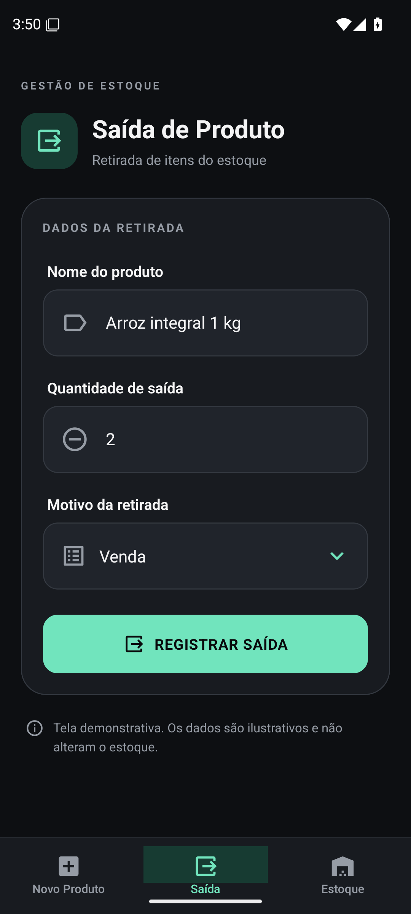
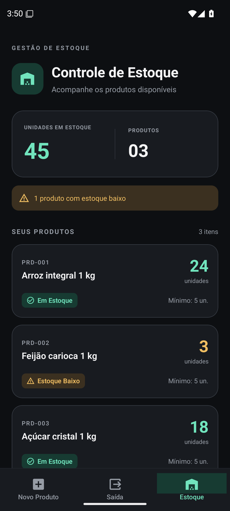

# Mini sistema de gestão de estoque

Atividade de Programação para Ambientes Móveis com React Native, Expo SDK 54 e TypeScript.

## Executar

```bash
npm ci
npm start
```

Abra no Expo Go compatível com o SDK 54 ou use um emulador Android. Para a versão Web, execute `npm run web`.

O acesso de demonstração mantém a validação local usada em aula. O login é apenas uma simulação para a atividade, sem conexão com um serviço de autenticação.

## Telas

| Tela | Conteúdo |
| --- | --- |
| Novo Produto | Nome, preço e quantidade de entrada; tela da atividade anterior. |
| Saída de Produto | Nome do produto, quantidade de saída e lista suspensa com Venda, Avarias e Uso Interno. |
| Controle de Estoque | Nome, quantidade, status e resumo do inventário com dados demonstrativos. |

Conforme permitido no enunciado, os dados das novas telas são estáticos e o botão de saída é ilustrativo. A lista suspensa e a navegação funcionam. O cadastro valida os campos, mas não grava produtos. Não há banco de dados nem movimentação real de estoque.

## Organização MVC usada na atividade

| Pasta/arquivo | Responsabilidade |
| --- | --- |
| `src/models/` | Tipos de produto e opções de motivo de retirada. |
| `src/controllers/` | Dados demonstrativos, cálculo de status/totais e validações de login/cadastro. |
| `src/pages/` | Páginas de login, produto, saída e estoque; cada página mantém seu `index.tsx` e `styles.ts`. |
| `src/components/` | Elementos visuais reutilizáveis: Input, Select, PageHeader e ProductCard. |
| `src/routes/index.routes.tsx` | Stack Navigator do fluxo Login → BottomRoutes. |
| `src/routes/bottom.routes.tsx` | Bottom Tab Navigator entre Novo Produto, Saída e Estoque. |
| `src/global/themes.tsx` | Cores compartilhadas. |

As pastas `components`, `pages` e `routes` seguem a separação do projeto de aula. Estados de apresentação, como abrir a lista suspensa, permanecem nos componentes. Regras de negócio e dados do inventário ficam nos controladores.

Os cabeçalhos são exibidos por `PageHeader` em cada tela. O cabeçalho dos navegadores fica oculto para remover o título genérico “BottomRoutes”. As abas usam `@expo/vector-icons` com os ícones `add-box`, `output` e `warehouse`, e a aba ativa recebe cor verde.

## Correções da avaliação anterior

1. Os campos do login são validados antes de `setLoading(true)`; `finally` libera o botão após a tentativa de login.
2. O `ActivityIndicator` usa a cor válida `#FFFFFF`.
3. O campo Senha usa `secureTextEntry`.

## Verificação e capturas

```bash
npm run typecheck
npx expo install --check
npx expo export --platform all
```

A verificação do GitHub também abre o aplicativo no Expo Go em um emulador Android API 35, testa o login e as abas e gera o artefato `prints-android` com capturas reais das duas páginas e da lista de motivos.

Para repetir essa captura localmente, mantenha um emulador Android iniciado com `adb` disponível e execute:

```bash
python3 scripts/capturar_android.py
```

As capturas são gravadas em `docs/prints/`. Os registros de diagnóstico e a captura de eventual falha ficam no mesmo diretório.

### Capturas reais da atividade

As imagens abaixo foram obtidas no aplicativo executando no Expo Go em um emulador Android API 35. A execução de verificação de login, navegação e seleção dos três motivos [foi aprovada no GitHub](https://github.com/ZzZnoonz/Tela/actions/runs/42246168677).

| Saída de Produto | Controle de Estoque |
| --- | --- |
|  |  |

[Ver a lista suspensa com os três motivos](docs/prints/motivos-retirada.png).
